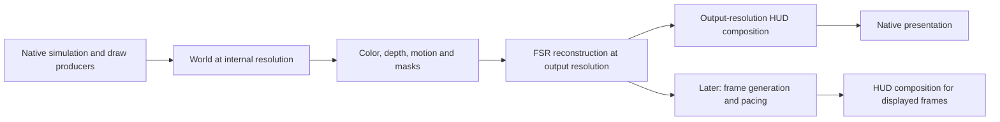

# FidelityFX implementation plan

Prepared October 29, 2026 for [issue #95](https://github.com/roswellien/MW3Recomp-Private/issues/95).
Status: proposed implementation sequence; no FSR runtime integration or performance
result is claimed. Source baseline: `647f018a72792c06b2da8c74da04aeb550144c21`
on `develop`. Recheck the affected sources before starting each implementation PR.

## Goal and scope

Add optional AMD FSR SDK 2.4.0 temporal upscaling to the Windows x64 native MW3
Vulkan renderer, followed by optional frame generation after the temporal inputs
and presentation lifecycle are validated. Preserve original simulation, guest
ABI/FP behavior, surface contracts and stock content. Enhancements remain explicit
settings under the [faithful modernization strategy](faithful-modernization-plan.md).

The first playable deliverable is live native Training with trustworthy temporal
inputs, sharp output-resolution HUD and working Off, NativeAA and Quality modes.
Frame generation is a separate deliverable. Campaign coverage, additional quality
modes and hardware support expand from measured results. This plan does not claim
whole-game fidelity or resume the historical startup audit.

## SDK choice

The [2.4.0 release](https://github.com/GPUOpen-LibrariesAndSDKs/FidelityFX-SDK/releases/tag/v2.4.0)
adds Vulkan parity for the relevant upscaling/frame-generation components. It
includes FSR 3.1.6 upscaling, ML upscaling 4.1.2, and separate frame-generation
and swapchain versions. SDK version and selected effect version are distinct.
The new driver-assisted pacing requires RX 9000-series or later and driver
26.10.1 or later; do not apply that requirement to every FSR path.

Use the common [FSR API](https://github.com/GPUOpen-LibrariesAndSDKs/FidelityFX-SDK/blob/v2.4.0/Kits/FidelityFX/docs/getting-started/ffx-api.md).
Enumerate compatible providers using the actual Vulkan device, query resource
requirements for the selected provider, and record the provider actually created.
Default selection may use driver-provided implementations. A diagnostic explicit
selection must use returned IDs consistently for queries and creation; never
invent or persist an opaque provider ID across machines or driver changes.

FSR 3 is the intended broadly compatible candidate; FSR 4 is available only when
the device/provider query and validation support it. Neither is a universal GPU
compatibility promise. Keep the established native-resolution renderer available.
Ray Regeneration and Radiance Cache are outside this plan: the tagged
[SDK limitations](https://github.com/GPUOpen-LibrariesAndSDKs/FidelityFX-SDK/blob/v2.4.0/Kits/FidelityFX/readme.md)
state that those effects do not support Vulkan.

## Current implementation and ownership

The maintained build now compiles `tools/m4-crt-heap-carry/host/` directly. Follow
[HOST_BUILD.md](../tools/m4-crt-heap-carry/HOST_BUILD.md); historical
`tools/remaster-launcher/native-overrides/` and `apply_*.py` inputs are not the
release source of truth. Update canonical sources and `host-source-manifest.json`
together. Add dependencies to the existing dependency receipt instead of creating
a second build or verification framework.

| Area | Existing source under `tools/m4-crt-heap-carry/host/` | Planned responsibility |
| --- | --- | --- |
| Vulkan device, images, draws and presentation | `vk_scene.hpp`, `quality_stage.inc` | Capability negotiation, separate resolutions, FSR dispatch and lifecycle |
| Guest graphics services and residency | `d3d_provider.inc`, `vdd.inc` | Frame boundaries, compatibility reads/writes and guest Flip semantics |
| Camera and retained geometry | `sun_camera_binding.hpp`, `sun_tl_capture_stage.inc`, `world_geometry_stage.inc`, `world_direct_stage.inc`, `mesh_override_stage.inc` | Validated current/previous camera and object data |
| HUD and deferred commands | `gpu_hud.inc`, `hud_deferred_stage.inc` | Output-resolution composition with original ordering and semantics |
| Shaders and materials | Existing world/model/TL shaders and `sun_scene.frag` | Jitter, velocity output and transparency treatment |
| Performance | `performance_monitor.hpp` | Reuse frame timing; add only missing CPU/GPU/presentation measurements |

`Scene` already carries world frame/generation/context metadata and eye position;
`ModelInstance` contains camera/projection and world-related transforms. These
are useful starting points, not established temporal identities or complete
motion-vector coverage. The maintained renderer already has D32 depth and applies
world FXAA before HUD scenes. Its Vulkan instance currently requests API 1.0;
FSR feature/extension and queue requirements must be negotiated explicitly.

Since the dated baseline above, the optional
[Vulkan/DXGI presentation bridge](dxgi-presentation-bridge.md) requests Vulkan 1.1
when enabled; the default Vulkan presentation path still requests 1.0. Validate
upscaling and frame generation against the actual selected presentation transport.
SDK Vulkan swapchain replacement alone does not establish compatibility with the
DXGI bridge. Keep unvalidated transport/effect combinations unavailable rather
than advertising them as supported.

Launcher integration belongs in
`tools/mw3-remaster-launcher/GraphicsPreferencesPanel.xaml[.cs]` and its existing
settings/launch argument path. Trace that path before changing serialization.

## Frame and resource contract

Proposed rendering order:

One temporal update represents one completed real world frame, not every
BeginScene/EndScene, draw, auxiliary view or displayed interpolated frame. Find and
validate that boundary before dispatch. Keep history per view/context; Mech Lab,
menus, auxiliary views and cinematics must not contaminate mission history.

Keep three explicit sizes: guest surface dimensions, internal world dimensions,
and output dimensions. Guest Lock/Blt/readback and z-buffer conversions retain
their recovered behavior. FSR output is a host presentation resource, not the
authoritative guest render target. Preserve command order when a guest read or
write occurs between world batches and HUD operations.

The integration needs a defined world color space, sampled depth, velocity and
appropriate masks, plus an output image suitable for the selected provider.
Allocate formats/usages from checked requirements, with explicit Vulkan barriers
and lifetime tracking. Avoid CPU image transfers in the normal FSR path. Confirm
depth sampling or a compatible conversion path; an existing depth attachment is
not automatically usable as an FSR input.

Follow the tagged [upscaler guide](https://github.com/GPUOpen-LibrariesAndSDKs/FidelityFX-SDK/blob/v2.4.0/Kits/FidelityFX/docs/techniques/super-resolution-upscaler.md):
motion describes current-to-previous pixel displacement, jitter is supplied with
the appropriate convention, and transparent effects benefit from reactive masks.
Declare actual depth orientation and projection parameters. Treat sky, alpha
testing, smoke, muzzle flashes, water and animated textures explicitly.

Jitter applies only to host rendering. Retain unjittered camera state for gameplay,
culling, input and HUD. For pretransformed vertices, prove the screen-space offset
and clipping behavior against the recovered projection. Moving objects require
previous object/part poses; camera reprojection alone only covers suitable static
geometry. Never pair objects by transient draw order. Reuse identities only after
checking allocation reuse, mission generation, damage, LOD and mesh replacement.

Use immutable renderer snapshots for asynchronous work. Keep guest memory, game
callbacks and guest FP state off presentation threads. Reset history on camera
cuts, mission/load transitions, view changes, incompatible size/provider changes
and any detected loss of valid history. Define pause/resume behavior without
feeding a long paused interval into temporal reconstruction.

## Ordered implementation PRs

Each row is a bounded task to file when ready, with its own issue, branch and PR
against current `develop`. Dependencies below are technical gates, not elapsed
time estimates. The largest uncertainty is stock/deformed/clipped geometry history.

| Phase | Deliverable and boundary advanced | Dependency | Completion evidence |
| --- | --- | --- | --- |
| P0: establish baseline and SDK feasibility | Pin SDK input and prove device/context compatibility; map complete real-frame and guest-access boundaries | None | Capability/context probe, baseline timings and a source-backed input coverage table; no public FSR setting |
| P1: separate world and output targets | Live world renders at independent internal resolution; HUD composes at output resolution | P0 frame contract | Native Training and menu/Lab transitions; matched Off rendering and guest readback checks |
| P2: camera history and depth | Correct camera-only velocities, jitter and resets for static world geometry | P1 | Analytic projection/depth checks plus live pan/turn/near-plane captures |
| P3: object history and masks | Motion coverage for original/replacement animated geometry and treatment of effects | P2 | Moving mechs, limbs, damage/LOD transitions, particles and clipped geometry checked in live native scenes |
| P4: optional FSR upscaling | Real frames pass through the queried Vulkan provider before HUD | P0-P3 | NativeAA and Quality playtests, Off restoration, resource validation and measured cost/quality |
| P5: settings and deployment | Persist supported choices and package a reproducible optional effect | P4 | Launcher-to-host settings, unsupported/missing-provider behavior, install/update/rollback |
| P6: optional frame generation | Real and generated frames are safely composed and paced | P4-P5 plus timing review | Presentation/threading lifecycle, latency, HUD and simulation checks on supported hardware |

### P0: resolve feasibility before broad changes

1. Record native host SHA, translated module identity, GPU/driver, resolution,
   settings and pack state. Reuse current performance counters and capture paths.
2. Inspect original and replacement model producers, retained world geometry,
   CPU-clipped draws, billboards, sky and HUD classification. For each class,
   record whether camera, stable identity, prior pose and transparency information
   exist and exactly where missing information can be recovered.
3. Pin the upstream tag to its full commit and the minimal signed distribution to
   its download URL and SHA-256. Record consumed headers, libraries and DLLs.
   Verify signatures, notices and dependencies; do not ingest the sample/media tree.
4. Use the SDK's actual requirements to choose Vulkan version, enabled features,
   extensions, compute-capable queue, descriptor and resource limits. Headers alone
   do not establish runtime support. Keep optional FSR negotiation from raising
   the baseline renderer requirement on unsupported devices.
5. Compile the smallest context/resource integration against our host toolchain.
   A successful sample or fixture establishes API compatibility only. Resolve
   toolchain/SDK incompatibilities before planning a live FSR dispatch.

**Gate:** if temporal coverage cannot be recovered faithfully, keep the feature
experimental and scope a specific producer-recovery task. Do not manufacture
zero vectors for moving opaque geometry or present a partial scene as readiness.

### P1-P3: establish trustworthy inputs

First validate world/output separation with FSR disabled and a simple diagnostic
scale operation. Preserve native-resolution HUD text, reticles, panels, fades,
color keys and overlays, including guest-written surfaces. Multiple world/HUD
segments may require more than the existing first-HUD FXAA trigger; prove the
complete frame ordering before substituting FSR there.

Add bounded previous-frame state owned by the renderer. Cover camera translation
and rotation, part articulation and donor deformation. Preserve clip interpolation
for previous positions when CPU clipping generates vertices. Reset or invalidate
history at spawn/despawn, pointer reuse, geometry/damage/LOD changes and load.
Reuse valid preprojection capture data where available; do not require optional
lighting or replacement packs just to produce temporal inputs for stock mode.

Extend existing geometry/depth/display tests where their setup covers these
contracts. A new temporal math test is justified only for coverage the existing
tests lack. It should catch wrong vector sign/scale, jitter contamination,
projection mismatch and history reuse; demonstrate failure with each covered
behavior deliberately broken, then restore it. Inspect velocity/depth/mask views
in live Training as well as fixtures.

### P4-P5: integrate and expose upscaling

Encapsulate FSR context creation, queries, dispatch, reset and destruction in a
small host-owned renderer component. Use `ffxCreateBackendVKDesc` with the actual
device context and check every return code. Wait for in-flight use before resize,
replacement or destruction. Rebuild dependent resources together on size changes.

Start with NativeAA and Quality. Query recommended dimensions and jitter; add
Balanced/Performance only after separate image-quality and performance checks.
Replace world FXAA on the FSR path. Keep sharpening bounded and avoid stacking
multiple sharpening passes by default. Follow the
[ML integration guide](https://github.com/GPUOpen-LibrariesAndSDKs/FidelityFX-SDK/blob/v2.4.0/Kits/FidelityFX/docs/techniques/super-resolution-ml.md)
for signed binaries, color-space handling and provider-specific resources. Verify
exposure and mip bias against the game's actual presentation, including optional
lighting; do not reinterpret legacy colors as linear without a measured baseline.

Settings: upscaling Off/NativeAA/Quality initially, bounded sharpening, and later
an independent frame-generation toggle. Default remains Off until explicitly
approved otherwise. Display the effective provider/mode and a clear unavailable
reason. Preserve requested preferences separately from applied capabilities.
Missing/unsupported optional FSR can select the native renderer with an explicit
message; invalid required guest services still fail visibly. On an FSR failure,
reconfigure only at a safe frame boundary; never report the requested mode as active.

Extend the existing host dependency and source manifests, packaging inventory,
runtime manifest and updater verification. Use an explicit trusted application
directory for runtime DLL loading. Ship only required signed components and their
[applicable notices](https://github.com/GPUOpen-LibrariesAndSDKs/FidelityFX-SDK/blob/v2.4.0/Kits/FidelityFX/docs/license.md);
the SDK is not uniformly covered by the project's MIT license. Keep originals,
generated game code and private build outputs outside Git.

### P6: frame generation as a separate integration

Use the tagged [frame-generation API](https://github.com/GPUOpen-LibrariesAndSDKs/FidelityFX-SDK/blob/v2.4.0/Kits/FidelityFX/docs/techniques/frame-interpolation-api.md)
and [Vulkan swapchain integration](https://github.com/GPUOpen-LibrariesAndSDKs/FidelityFX-SDK/blob/v2.4.0/Kits/FidelityFX/docs/techniques/frame-interpolation-swap-chain.md).
Choose a supported HUD composition method using host-owned images/commands.
Callbacks may reuse captured UI state but must not reexecute guest drawing,
advance random state or update simulation for an interpolated frame.

Replace swapchain operations through the SDK's returned functions; audit queue
serialization, semaphores, presentation threads, image ownership and teardown.
Keep real-frame IDs and guest Flip completion separate from generated presents.
Test minimize/restore, resize, focus changes, pause, load, provider failure and quit.
Disable generation for unvalidated menus, video, view transitions or invalid input
history. Choose a minimum real-frame-rate policy from measured latency/artifacts;
do not hard-code an untested threshold or advertise generated FPS as simulation FPS.

## Validation and release gates

Use the existing host build and narrow tests against canonical sources. Historical
tests that prepare patched copies must be adapted to exercise the maintained host
before they count as coverage. Extend `test_depth32.cpp`, `test_world_geometry.cpp`
and `test_launcher_display.cpp` where applicable; inspect existing coverage first.
Ordinary code PRs also follow build/CTest/format/style and independent review rules
in [CONTRIBUTING.md](../CONTRIBUTING.md). This documentation PR needs only evidence,
link and diff checks.

| Scenario | Required observation |
| --- | --- |
| Off, stock content and stock lighting | Matched camera/state comparison; no new gameplay, surface, HUD or presentation defects |
| NativeAA and Quality, Training/Instant Action | Correct motion under walking/torso rotation, stable terrain and thin detail; no persistent ghost trails or HUD reconstruction |
| Effects and replacements | Smoke, weapons, water, articulated/damaged/LOD-switched mechs and optional lighting each have checked input treatment |
| Transitions | Menu/Lab/mission/cinematic/save-load/pause/resize/quit retain correct composition and reset history |
| Hardware | At least a supported ML provider, a non-ML provider configuration and an unsupported/missing-component configuration; label untested vendors/drivers |
| Frame generation | Real/rendered/displayed rates reported separately; input latency and guest timing compared with generation Off |
| Deployment | Clean install, upgrade, missing/tampered dependency rejection, effective settings and rollback to native rendering |

Compare identical scenes/settings at output resolution with Off, NativeAA and
Quality. Record CPU time, GPU time, FSR cost, frame-time percentiles and peak GPU
memory after warmup. Add GPU timestamps only if existing instrumentation cannot
answer the bottleneck question. Upscaling must show a net GPU-time benefit in a
GPU-limited case to justify a performance claim; CPU-limited results remain
explicit. Establish image-error tolerances from the affected contract, and record
visual review decisions rather than inventing a universal similarity threshold.

Release only through a reviewed `develop` to `main` PR and build from merged
`main`, recording its SHA and dependency receipts. Follow
[release filenames](release-filenames.md): game `<version>.mw3update`, launcher
`<version>.ccupdate` when changed, and installer `corecriticalinstaller-<version>.exe`
using the exact build-receipt filename. Preserve signed metadata consistency and
historical URLs. No release version is assigned by this plan.

## First implementation task and open decisions

Start with P0: trace real-frame completion and temporal-input coverage in the
canonical host, pin/probe the SDK, and collect a small matched performance
baseline. Then implement P1. This sequence advances presentation resources before
exposing an effect whose inputs are incomplete.

Resolve these with evidence during P0-P3:

- Which stock/CPU-clipped/deformed producers need additional prior-pose capture?
- Can current world generation/context metadata safely key history for every view?
- Where do guest writes or deferred HUD/world draws interrupt final composition?
- Which provider-required Vulkan features are supported by the actual target PCs?
- What is the existing world color/exposure contract with lighting On and Off?
- Does the current real-frame workload leave enough GPU budget for reconstruction
  and, later, frame generation at the intended output resolution?

Track implementation results using [project status reporting](project-status-reporting.md):
demonstrated native behavior, affected fidelity, defects and release validation.
The plan itself advances no native execution boundary.
